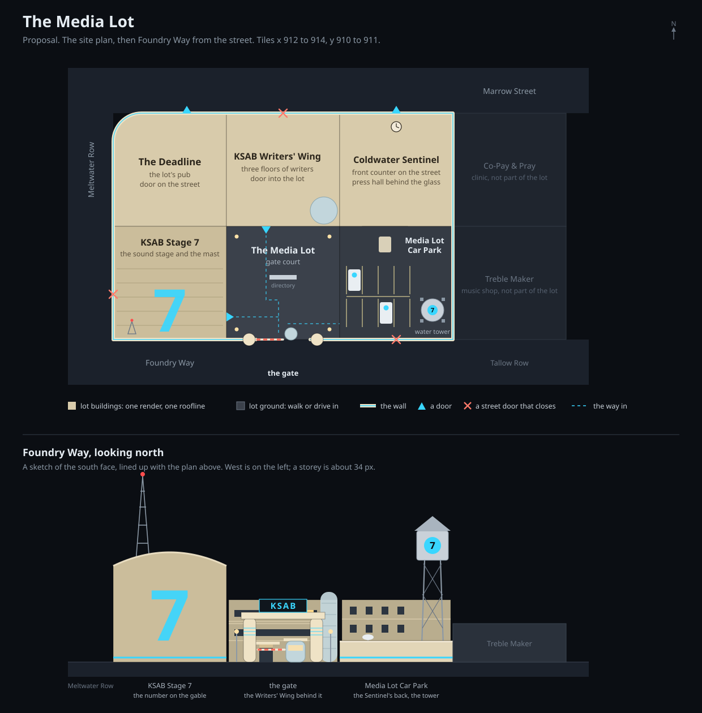

# The Media Lot *(as built)*

**Status: phases 1, 2 and 3 BUILT.** KSAB's block between
Marrow Street, Meltwater Row and Foundry Way, walled like a Hollywood studio lot. Phase 1 (2026-10-18)
took Wrap Party and Just My Type off the map, made their two tiles the lot's gate court and car park,
turned the stage and the Writers' Wing to open onto the court, gave the Sentinel a press hall and the
gate a guard, and drew the wall, the gate and the car park in GLASS. Phase 2 (2026-11-03) redrew the
buildings in one hand. Phase 3 (2026-11-03) added the paper's morgue and a writers' room, and made the
barrier lift, the vans go out with the news and the headlines run along the Sentinel.

The content is written by [scripts/content/media-lot.mjs](../../scripts/content/media-lot.mjs) and
[scripts/content/media-lot-rooms.mjs](../../scripts/content/media-lot-rooms.mjs). The ground is drawn
by [glass/media-lot.js](../../client/game/js/panels/glass/media-lot.js) and the buildings by
[glass/models/lot-buildings.js](../../client/game/js/panels/glass/models/lot-buildings.js).



## 1. The idea

A Hollywood lot is one owner's walled block: a gate with a guard in a booth, sound stages with
their numbers painted on the walls, an office block where the writers work, a water tower with the
studio's logo on it, and everybody's car parked inside. This block had most of that already: KSAB's
stage and its writers' building, the city paper, and the press bar on the corner. It was missing
the wall, the gate and the car park.

The story, to be written properly in the house voice: KSAB walled its block when the transmitter
went up and put the gate on Foundry Way. The Sentinel was on Marrow Street first, so the wall was
built up to the paper's back door; the paper parks its vans in the station's car park, and the
station reads the paper's headlines on air. The Deadline is built into the corner of the wall with
its door on the street, so a crew can drink without signing out.

## 2. The block before

| Tile | Building | Door | Model | Audit |
|---|---|---|---|---|
| 912,910 | The Deadline (`bar`) | north, Marrow Street | authored: cream streamline moderne, a corner drum | 10 |
| 913,910 | KSAB Writers' Wing (`studio`) | north, Marrow Street | authored: a two-storey glass pavilion | 8 |
| 914,910 | Coldwater Sentinel (`office`) | north, Marrow Street | authored: grey deco stone, a gilt frieze | 11 |
| 912,911 | KSAB-TV Studio Stage (`studio`) | west, Meltwater Row | the `ksabstudio` arm: a galvanised stage, black plant, the mast | 14 |
| 913,911 | Just My Type (`store`) | south, Foundry Way | authored: a jobbing printer | 3 |
| 914,911 | Wrap Party (`bar`) | south, Foundry Way | authored: a back-door pub | 3 |

The scores are out of 16 against the clone facility, from
[the 2026-10-04 grade](../audits/findings-2026-10-small-buildings.md). Two fix passes since then
(frontages and lamps, then doors) reached several of these and nobody has re-scored them. Each
building is reasonable on its own. Side by side they were six styles by six hands, and nothing on
the street said they belonged to one place.

## 3. The layout *(built)*

| Tile | Zone | What | Door |
|---|---|---|---|
| 912,910 | `zone_medialot_912_910` | **Media Lot Backlot** (was the Deadline, set aside 2026-10-19) | open to the stage and the Writers' Wing, walled on both streets |
| 913,910 | `zone_district_913_910` | **KSAB Writers' Wing** | south into the court (was north onto Marrow Street) |
| 914,910 | `zone_district_914_910` | **Coldwater Sentinel** | south onto the car park (north onto Marrow Street until 2026-10-19) |
| 912,911 | `zone_district_912_911` | **KSAB-TV Studio Stage** | east into the court (was west onto Meltwater Row) |
| 913,911 | `zone_medialot_913_911` | **The Media Lot**, the gate court: open concrete | the gate, south onto Foundry Way |
| 914,911 | `zone_medialot_914_911` | **Media Lot Car Park**: open concrete | open to the court, walled on Foundry Way |

- **The gate is on Foundry Way**, the only street the two freed tiles touch.
- **Inside the wall,** the stage and the Writers' Wing open onto the court and the car park opens
  off it. Until 2026-10-19 the Deadline and the Sentinel kept their street doors; now every door
  on the block is inside the wall (below).
- **Three street doors closed.** Meltwater Row (911,911) lost its way into the stage, Marrow Street
  (913,909) its way into the Writers' Wing, and Foundry Way (914,912) Wrap Party's old door, which
  is a blocked connection now (`conn_district_914_912_north_ygvl`). The other two needed no file,
  because a facade's other three sides are walls already.
- **The walk got longer.** From Marrow Street the Writers' Wing is nine moves, round by Meltwater
  Row and through the gate, where it was one.
- **The lot's staff walk in through the gate:** ten NPCs on the stage floor, the doorman and the box
  office at the stage door, and Sunny Vantz's cart on the Writers' Wing's story floor.
- ⚠ **`sitecheck.mjs` fails both tiles, correctly.** It asks whether a building could go there, and
  the answer is no: the court is the only way into the lot and the street of two buildings, and the
  car park has no street door. Never build on either.

### The block closed *(built 2026-10-19)*

David asked for the rest of the block closed off, with every door inside the lot. The lot's wall now
runs the whole way round:

- **The Deadline is set aside** on `map_set_aside` at 5,9, with Corva (`npc_greenroom_bartender`)
  and Ivor Marrow (`npc_greenroom_guest`). They move into the lounge and the booth, since a
  set-aside keeper sleeps in a set-aside room, and Ivor's residence row on Solenne flat A passes to
  Jerry Rosenberg, who shares the flat.
- **Its tile is the backlot** (`zone_medialot_912_910`, part `backlot`): a scene dock walled on Marrow
  Street and Meltwater Row, painted flats leaning on the wall and crates by the stage. It's reached
  from the stage's facade (north) and the Writers' Wing's (west).
- **The Sentinel turned** to open south onto the car park beside its dock. Its link into the bullpen
  kept its id and turned north; the press hall moved to the bullpen's north (grid 0,-1), and its
  shop door turned with it. Marrow Street has no door on the block now.
- **The buildings carry the wall.** A building tile with `flags.media_lot.part: 'building'` keeps its
  mass and takes no mark; the derive gives it `ml.p = 'x'`, and the sweep draws the wall along its
  street faces before the building (the stage on `ws`, the Writers' Wing on `n`, the Sentinel on
  `ne`). The derive counts only exits onto `map_world`, so a building's link into its rooms doesn't
  open its wall.
- Dot no longer sends anyone to the bar, and the usher and the Palais box office no longer name it.

## 4. What came off the map

Just My Type and Wrap Party are set aside, not deleted, the way the Coliseum's block was
([hughson-coliseum.md](hughson-coliseum.md), §3) and Meltwater Row's four were:

- Both facades moved onto `map_set_aside` on row 9 (Just My Type at 1,9, Wrap Party at 3,9), clear
  of the Coliseum's block (rows 1 to 3), the Kettle three (row 5) and Meltwater Row's four (row 7).
  They keep their ids, prose, flags, interiors, junction boxes and connections into their rooms.
  Each carries `flags.set_aside` and `set_aside_from`, its `world_exit_zone` names itself, and
  nothing on the holding map links to the world.
- The lot's two tiles took new ids, so nothing was overwritten. The models stay registered.
- **Birdie Stavros** is set aside with her bar.
- **Pavel Ludd** moved to the Sentinel and took his shop with him: his flatbed, its twin under a
  sheet, the drying line and the type cases (`furn_justmytype_1` to `_4`) stand in the press hall
  now. Just My Type keeps its lights and junction box, so the set-aside check still finds furniture
  inside it. His greeting says "board on the door" for "board outside", and his first meeting names
  the paper's press as well as his two.
- After the deploy, `scripts\oneshots.bat prod` runs
  [set-aside-players.mjs](../../scripts/oneshots/set-aside-players.mjs), which moves anyone and
  anything still in the two rooms.

## 5. Inside

| Room | Where | What's in it |
|---|---|---|
| Press Hall (`zone_sentinel_press`) | south of the Sentinel's bullpen | the paper's rotary press, Ludd's two flatbeds, the drying line, the type cases, the jobbing board; Pavel Ludd |
| KSAB5 Writers' Lounge (`zone_ksab_lobby`) | the old Writers' Wing, inside its door | the sports writers' sofas, urn and whiteboard of tonight's games |
| KSAB5 Studio (`zone_ksab5_stage`) | east of the lounge | the live stage: a sports desk, three cameras, a low grid |
| KSAB5 Production (`zone_ksab5_prod`) | over the studio | the vision mixer, the outside-broadcast feeds, KSAB5's deck |
| KSAB-TV Writers' Room (`zone_ksab7_writers`) | north of the stage floor | the long table and the index cards |
| KSAB-TV Green Room (`zone_ksab7_green`) | south of the stage floor | where the guests wait |
| The Morgue (`zone_sentinel_morgue`) | west of the Sentinel's bullpen | the paper's clippings: two walls of steel cabinets and a reading table, its scissors on a chain |
| KSAB5 Writers' Room (`zone_ksab5_writers`) | up from the lounge, by the stair drum | the long table, the fixture board, and the lamp you can see from the street |

**The Writers' Wing is KSAB5's building** (2026-10-28), written by
[scripts/content/ksab-rooms.mjs](../../scripts/content/ksab-rooms.mjs). The facade, the story floor
and the script vault kept their ids; only the names changed, and the authored model's bind and signs
went with them (`KSAB5`, `ALL GAMES LIVE`). KSAB5's `studio_zone_id` is still null, so the broadcast
plugin treats its studio as scenery: its games come from the grounds, not the desk. Each new room has
a `power_zones` row off its building's generator and an overhead light; authored lights import off,
so they need the lights one-shot after the deploy.

**The morgue and the writers' room** (2026-11-03) are written by
[scripts/content/media-lot-rooms.mjs](../../scripts/content/media-lot-rooms.mjs). Both are scenery you
can `examine`, with no mechanic: the morgue's cabinets are flavour, not a search. Each has a
`power_zones` row off its building's generator and a fixture. The writers' room is on grid z 1 beside
KSAB5 Production, with a blocked connection between them (`conn_ksab5_prod_west_7dpn`). Its lamp is the
one lit bay on the model's top floor.

⚠ **The press hall is a room of its own because a counter shuts.** A room a vendor works in is a
shop and locks outside his hours (plugins/commerce/shopdoor.js), and the bullpen is the only way to
the editor's office. The press hall has a shop door (`door_shop_sentinel_press`) on its own
connection, a `power_zones` row off the bullpen's junction box, and a 2,600-lumen fixture. Ludd
sells handbills from 08:00 to 19:00 as "Sentinel Press Hall".

**Dot Kowalczyk** (`npc_ksab_gate`) keeps the gate, 06:00 to 22:00 every day, on the vendor graph
with nothing to sell, as Orsino Tull keeps the stage door, so the court is never a shop and never
shuts. She stops nobody (decision 6). Her greeting is split (`first`, `known`, `familiar`) and she
answers what the lot is, where the stage door is, whether you can park, and where the bar is. She
shares Meridian 404 with the Ration Nine cook, whose residence row covers the flat.

The stage's floor lost its "shopfront window", because a sound stage has none; its own lamps light
it. The Writers' Wing's story floor kept its window, which looks onto the court now.

## 6. The look

### One hand for the lot

The Deadline already wears the lot's style: 1930s streamline moderne in cream render, the corner
turned with a drum, three string courses for speed lines, a wrapped canopy. It's the style the 1930s
broadcasters built their studios in (CBS's Columbia Square and NBC's Radio City in Hollywood), and
the lot takes it across all six tiles:

- **One render.** Every wall on the lot is the colour of the Deadline's `ty_dw_paint`. The GL atlas
  has almost no room for new palette keys (`atlasfit`), and one colour on six tiles is also what
  makes them read as one owner's.
- **One roofline.** One plinth height and one parapet height across the buildings, with only the
  stage rising above it.
- **One accent.** A band of the station's cyan along the foot of every wall, and round the gate
  piers as their speed lines. It's paint and light, so it costs no key.
- **One lettering face** for the lot's own signs. The Sentinel's masthead keeps its gilt `deco`
  hand, because it's the paper's.
- **Period glazing:** steel casements, ribbon windows, and glass block in the stair drums.

### The ground *(built)*

All of it is in [glass/media-lot.js](../../client/game/js/panels/glass/media-lot.js), sized in metres
off one constants block, `LOT`.

- **The gate.** Two rendered piers with three cyan speed lines, a slab across them, and a dark board
  on the slab with KSAB in block capitals (cyan, lit after dark). A red-and-white barrier arm that
  lifts for a rig (§7), and the gatehouse inside the gate: a round booth glazed all round under a flat lid with a cyan
  rim, warm-lit at night. Short runs of wall either side of the piers close the court's Foundry Way
  side.
- **The court.** Painted walks from the gate north to the Writers' Wing and west to the stage door,
  three lamp standards, a directory board facing the gate and a lot cart under a cyan canopy (the
  board and the cart only within arm's length).
- **The car park.** The wall along Foundry Way and against Treble Maker: a storey of render over a
  darker plinth, a coping, and the cyan band on both faces, a lit strip after dark. Two ranks of
  painted bays, two KSAB news vans with the station's disc and a folded mast, a satellite van along
  the east wall, the Sentinel's slate van backed onto a concrete dock at the paper's back wall, a
  lamp, and the water tower in the south-east corner: four splayed legs, braced, a galvanised tank
  with two hoops, a cone and a red lamp on top, and the station's disc with its 7 on the street side
  and the court side, floodlit at night.

### The three buildings *(built 2026-11-03)*

All three are arms in [glass/models/lot-buildings.js](../../client/game/js/panels/glass/models/lot-buildings.js),
bound by name in `NAMED_MODELS`, with `noKit`, and sized from the `LOT` constants the ground uses
rather than `fh` and `h` (both are rolled per tile; the Palais, Golden Goose Gardens and the Coliseum
keep their buildings in constants for that reason). Their words are in the registry row. The authored
files `ksabwriterswing` and `coldwatersentinel` and the arms `ksabstudio`, `studiogate` and `sentinel`
are gone. The cost is that the three can't be edited as JSON in the Modelshop any more.

⚠ **There are three, not four.** This section was written for four, before the block closed. The
Deadline is set aside and doesn't stand on the lot, so it keeps its authored model, `thedeadline`, as
Just My Type and Wrap Party keep theirs. What it gives the lot is the corner: the backlot's two walls
turn on a rendered drum with three speed lines, where the bar's drum stood.

**KSAB-TV Studio Stage.** A blind render shell under a shallow barrel with its gables north and south,
no windows and no rooflights. Air handling on a deck along the crown, and the mast out of a house
through the barrel. The Meltwater Row side carries the call letters once, four at a time so the A can
stay dark after dark (`m.dead`, as the description says). The Foundry Way gable has a 7 the height of
the wall. The court side is the working face: the scene dock with its elephant door, then a lean-to
with the stage door, the ON AIR lamp over it (the broadcast plugin's live state), the box office window
with its card, and the doorman's rope. The backlot gable has the scene door the flats go through.

**KSAB5.** It was the Writers' Wing (§5). Three storeys of ribbon windows between the speed lines,
blinds down to a different height in every bay, and one bay on the top floor lit whatever the hour. A
glass-block stair drum on the court corner, rising past the parapet. The door is under a flat canopy on
a pier up the middle of the court side with the name over it, and the marquee and the wall of monitors
are beside it. The Marrow Street side carries the same ribbons and no door.

**Coldwater Sentinel.** Render and black glass, the way the Daily Express built. On Marrow Street, above
the lot's wall: the press hall's five tall lights with the press behind them, a train of drums that
shows dark against the lit hall after dark, because the press runs at night; black glass with a clock
in it; and the masthead in gilt under the coping, in the paper's own `deco` hand. ⚠ **The hands are
stopped at five to midnight,** because a clock that keeps time moves, and §4.5 keeps movement rare. The
front counter and its wire cage aren't drawn: the paper lost its street door when the block closed, and
the wall covers that storey. Along the top of the wall runs the ticker (§7), a black band in a steel
housing. On the car park side, the steel door, the wired window with the feed
screens and a roller shutter over the dock.

A building gets its name once ([building-styles.md §4.1](../reference/building-styles.md)). The gate
carries the lot's name, the water tower carries the logo and no words, the stage carries its call
letters and its number, and KSAB5 and the Sentinel each carry their own name once.

Each has a footprint of its own on the map through `flags.map_icon`, since the stage and KSAB5 share
the `studio` type: [bldg_soundstage](../../client/game/assets/zone-icons/bldg_soundstage.svg),
[bldg_ksab5](../../client/game/assets/zone-icons/bldg_ksab5.svg) and
[bldg_sentinel](../../client/game/assets/zone-icons/bldg_sentinel.svg). KSAB5's marker is `K5`.

⚠ **The barrel's capture is a quarter turn out.** `drawBarrelRoof` only sweeps along local y, so the
arm hands it a frame turned a quarter, and the capture keeps the extents in its own frame. The shell is
square so the footprint comes out the same; only the crown's line differs, by the rise at the eaves.

Checks: `shapes:smoke`, which holds `gl:mesh`, `sign:stand`, `signband`, `sign:fit`, `gl:self`,
`gl:mat`, `atlasfit` and `models:quality`, and [scripts/shapes/medialot.mjs](../../scripts/shapes/medialot.mjs),
which holds the arms to constants and keeps their mass out of the wall.

## 7. How it works

### Content

```bash
node scripts/content/media-lot.mjs [--dry-run]
node scripts/content/mint-connections.mjs --write
npm run content:lint
```

The script is idempotent, every id comes from a tile or a slug, and it refuses to run if the two
set-aside tiles aren't the buildings it expects. It turned each facade round with its id: the
facade's connection into its rooms kept its id (a lock grant is keyed by it) and turned
(`conn_district_913_911_east_wegl` to west, `conn_district_913_910_south_373a` to north), the stage's
door row turned with it, and the Writers' Wing's Script Vault and its utility room moved to the
north of the story floor, whose way out is south now. The new zone flag, `media_lot`, is in the tag
catalog and [flags-keys.md](../flags-keys.md).

**What didn't change:** the interior rooms and their ids (the channel 7 cameras and the studio room
the broadcast plugin reads, the Sentinel's bullpen and editor's office, the Deadline's lounge and
booth); the facade ids, because the stage's doorman and box office stand on its facade tile and
[audience.js](../../plugins/broadcast/audience.js) looks for them there; and the four buildings'
names, types and map codes, so they needed no new icons.

### GLASS

- **The ground is a mark,** `lot`. [plugins/flight/state.js](../../plugins/flight/state.js) turns
  `flags.media_lot` into `ml` on the cell: `p` the part, `w` the walled sides and `g` the gate's
  side. ⚠ **The wall and the gate follow the movement graph,** for the South Lock's reason: content
  names the sides, and the derive keeps a wall only where the tile has no exit and a gate only where
  it has one.
- **`drawLotMark`** in windshield.js hands glass/media-lot.js a face sink, a light sink and a
  lettering sink, the way the AA batteries are drawn: on GLASS 2 the faces go to `BAY_SINK` and the
  depth buffer, on GLASS 1 they're sorted and painted at the tile's depth. ⚠ The gate's lettering
  names its face (`block`); left to default it took the last building's, and came out in a bar's
  script.
- **A truck stops at the wall** and drives through the gate: `lotWallZAt` beside `lockWallZAt` in
  `groundObstructionAt`, reading `lotSolidAt` off the same constants the drawing uses. Walls are a
  band either side of their line, so a rig at speed can't pass through one between samples; the
  piers, the gatehouse, the vans, the dock and the tower's legs are solid as drawn. The gate lane is
  open from the street through the court, so a rig can drive in and `park`, and the trucking plugin
  lists it in the room.

- **The wall on the map.** [`lotSides` in derive.mjs](../../scripts/content/derive.mjs) is the one rule,
  and state.js and the map both call it. The derive writes `spec.lot_wall` and `spec.lot_gate`, and the
  minimap, its canvas path and the tablet map draw them on the tile's edges in the Curtain's classes
  with the lot's own ink: cream render, and the gate's two stubs in cyan.
- **An aircraft hits the water tower.** `lotAirTopAt` is a post at the catwalk's radius up to the tip of
  the cone, and `lotRoofFtAt` puts it in the CFIT sweep beside `curtainRoofFtAt`. It stays out of
  `modelTopAt`, because a tank isn't a deck.
- **The barrier and a van on the move are the dynamic part** of the lot's mark, so the rest stays kept
  (`markKept`, with the bays that hold a van in its key). ⚠ Neither is mass: the arm has none, and `lotSolidAt` counts a news van only in its bay.
- **The barrier** lies across the lane and lifts for a rig from `_bayVehicles`, or for a van, sensed the
  way a depot door is (`lotArmSense`). It has a motor (`lotArmTravel`), so a rig going by on Foundry
  Way barely stirs it. It stops nobody.
- **The vans go out with the news.** The broadcast plugin adds `news` to `studio_live`, true while a
  station with a stage airs a `news` slot (KSAB-TV, 08:00 to 10:00). They leave a few seconds apart by
  the aisle, the court and the gate, and go west down Foundry Way. They come back the same way, run past
  their bay and reverse in. A client that logs in during the news finds the bays empty. `zone.describeRoom`
  says which, so the car park's own prose leaves them out.

- **The ticker** was checked with David, because it moves (2026-11-03). The broadcast plugin reads the
  day's headlines off `news.getStories`, at most once a minute, and sends `headlines` only when they've
  changed, plus once at login. `flags.media_lot.ticker` names the side, and the derive carries it as
  `ml.t`. The housing is mesh in the paper's arm; the letters are the lot's dynamic part. ⚠ They're one
  decal each from about forty cached glyphs, so nothing bakes while it runs, and they aren't in the arm,
  so the arm stays kept. They're drawn within arm's length only, from the street side, and sit still with
  motion off.

### Tests

- `tests/regress.js` walks in from Foundry Way through the gate, east into the car park, finds the
  Foundry Way wall, and back out; finds Meltwater Row's door into the stage gone; reads the turned
  doors off the exits (both entry rooms are counters, and the stage door is ticketed on a taping
  night); checks the set-aside, Ludd's press hall, that nobody keeps a counter in the bullpen, that
  Dot sells nothing, the derived mark, and that a truck clears the gate and stops at the wall.
- `markRenderSmoke` draws both parts and a gate on every side, near and far, by night and day.
- [scripts/shapes/medialot.mjs](../../scripts/shapes/medialot.mjs) holds the buildings to constants and
  out of the wall, the tower in the CFIT sweep, one rule for the wall, the barrier's sense and motor,
  a van solid only in its bay, and the ticker's letters inside their band.

## 8. Decisions

David went with every recommendation on 2026-10-18:

1. **The gate on Foundry Way.**
2. **The Writers' Wing's door inside the wall.**
3. **Pavel Ludd to the Sentinel, Birdie Stavros set aside.**
4. **The Sentinel joins the lot's render** (phase 2).
5. **The gate says `KSAB`,** with the disc on the water tower.
6. **Nobody is checked at the gate.**

## 9. What isn't built

- No new mechanic: no pass at the gate and no parking charge. Players don't own cars; the car park
  takes trucks, and its vans are scenery.
