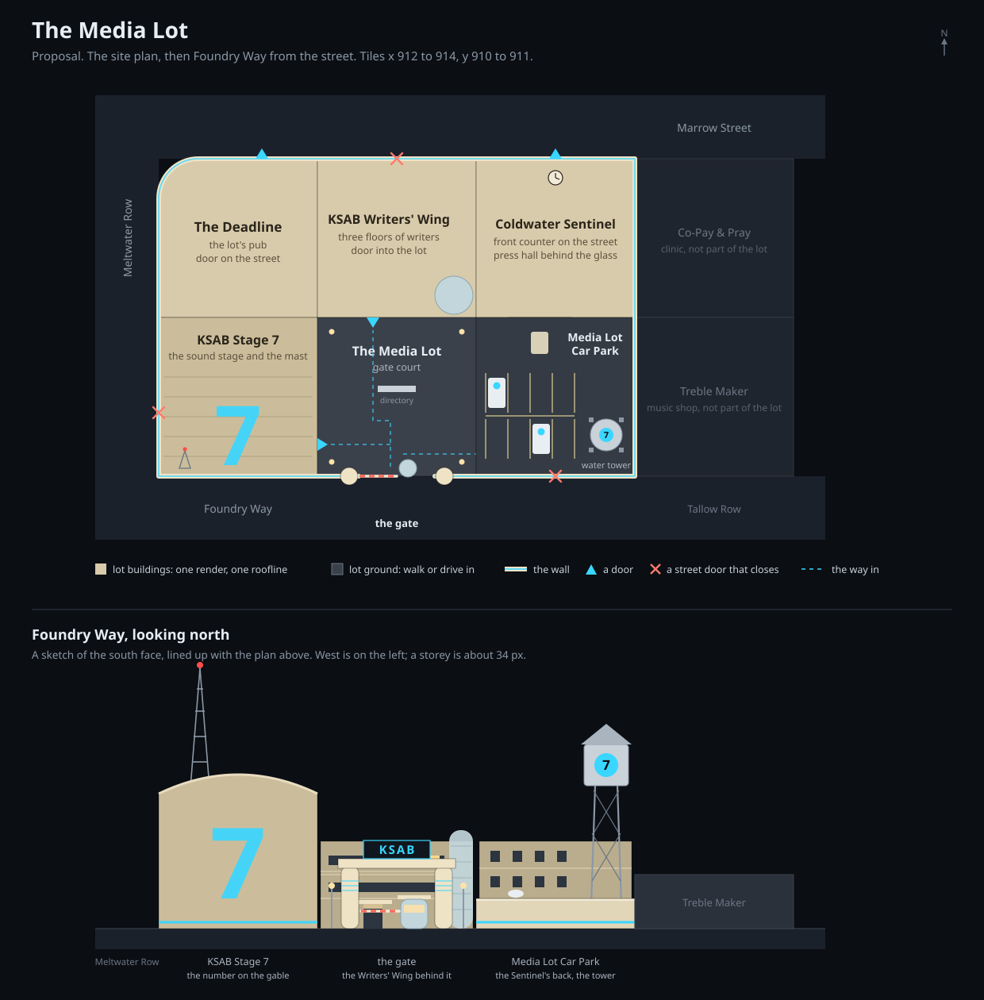

# The Media Lot *(phase 1 built)*

**Status: phase 1 BUILT; phases 2 and 3 are design.** KSAB's block between Marrow Street,
Meltwater Row and Foundry Way, walled like a Hollywood studio lot. Phase 1 (2026-10-18) took Wrap
Party and Just My Type off the map, made their two tiles the lot's gate court and car park, turned
the stage and the Writers' Wing to open onto the court, gave the Sentinel a press hall and the gate a
guard, and drew the wall, the gate and the car park in GLASS. Phase 2 redraws the four buildings in
one hand; phase 3 is inside and alive.

The content is written by [scripts/content/media-lot.mjs](../../scripts/content/media-lot.mjs) and
the ground is drawn by [glass/media-lot.js](../../client/game/js/panels/glass/media-lot.js).



## 1. The idea

A Hollywood lot is one owner's walled block: a gate with a guard in a booth, sound stages with
their numbers painted on the walls, an office block where the writers work, a water tower with the
studio's logo on it, and everybody's car parked inside. This block had most of that already: KSAB's
stage and its writers' building, the city paper, and the press bar on the corner. It was missing
the wall, the gate and the car park.

The story, to be written properly in the house voice: KSAB walled its block when the transmitter
went up and put the gate on Foundry Way. The Sentinel was on Marrow Street first, so the wall was
built up to the paper's back door; the paper parks its vans in the station's car park, and the
station reads the paper's headlines on air. The Deadline is built into the corner of the wall with
its door on the street, so a crew can drink without signing out.

## 2. The block before

| Tile | Building | Door | Model | Audit |
|---|---|---|---|---|
| 912,910 | The Deadline (`bar`) | north, Marrow Street | authored: cream streamline moderne, a corner drum | 10 |
| 913,910 | KSAB Writers' Wing (`studio`) | north, Marrow Street | authored: a two-storey glass pavilion | 8 |
| 914,910 | Coldwater Sentinel (`office`) | north, Marrow Street | authored: grey deco stone, a gilt frieze | 11 |
| 912,911 | KSAB-TV Studio Stage (`studio`) | west, Meltwater Row | the `ksabstudio` arm: a galvanised stage, black plant, the mast | 14 |
| 913,911 | Just My Type (`store`) | south, Foundry Way | authored: a jobbing printer | 3 |
| 914,911 | Wrap Party (`bar`) | south, Foundry Way | authored: a back-door pub | 3 |

The scores are out of 16 against the clone facility, from
[the 2026-10-04 grade](../audits/findings-2026-10-small-buildings.md). Two fix passes since then
(frontages and lamps, then doors) reached several of these and nobody has re-scored them. Each
building is reasonable on its own. Side by side they were six styles by six hands, and nothing on
the street said they belonged to one place.

## 3. The layout *(built)*

| Tile | Zone | What | Door |
|---|---|---|---|
| 912,910 | `zone_district_912_910` | **The Deadline**, the lot's pub | north onto Marrow Street, as before |
| 913,910 | `zone_district_913_910` | **KSAB Writers' Wing** | south into the court (was north onto Marrow Street) |
| 914,910 | `zone_district_914_910` | **Coldwater Sentinel** | north onto Marrow Street, as before |
| 912,911 | `zone_district_912_911` | **KSAB-TV Studio Stage** | east into the court (was west onto Meltwater Row) |
| 913,911 | `zone_medialot_913_911` | **The Media Lot**, the gate court: open concrete | the gate, south onto Foundry Way |
| 914,911 | `zone_medialot_914_911` | **Media Lot Car Park**: open concrete | open to the court, walled on Foundry Way |

- **The gate is on Foundry Way**, the only street the two freed tiles touch.
- **Inside the wall,** the stage and the Writers' Wing open onto the court and the car park opens
  off it. **On the street,** the Deadline and the Sentinel keep their doors, so the pub and the
  paper's front counter stay public.
- **Three street doors closed.** Meltwater Row (911,911) lost its way into the stage, Marrow Street
  (913,909) its way into the Writers' Wing, and Foundry Way (914,912) Wrap Party's old door, which
  is a blocked connection now (`conn_district_914_912_north_ygvl`). The other two needed no file,
  because a facade's other three sides are walls already.
- **The walk got longer.** From Marrow Street the Writers' Wing is nine moves, round by Meltwater
  Row and through the gate, where it was one.
- **The lot's staff walk in through the gate:** ten NPCs on the stage floor, the doorman and the box
  office at the stage door, and Sunny Vantz's cart on the Writers' Wing's story floor.
- ⚠ **`sitecheck.mjs` fails both tiles, correctly.** It asks whether a building could go there, and
  the answer is no: the court is the only way into the lot and the street of two buildings, and the
  car park has no street door. Never build on either.

## 4. What came off the map

Just My Type and Wrap Party are set aside, not deleted, the way the Coliseum's block was
([hughson-coliseum.md](hughson-coliseum.md), §3) and Meltwater Row's four were:

- Both facades moved onto `map_set_aside` on row 9 (Just My Type at 1,9, Wrap Party at 3,9), clear
  of the Coliseum's block (rows 1 to 3), the Kettle three (row 5) and Meltwater Row's four (row 7).
  They keep their ids, prose, flags, interiors, junction boxes and connections into their rooms.
  Each carries `flags.set_aside` and `set_aside_from`, its `world_exit_zone` names itself, and
  nothing on the holding map links to the world.
- The lot's two tiles took new ids, so nothing was overwritten. The models stay registered.
- **Birdie Stavros** is set aside with her bar.
- **Pavel Ludd** moved to the Sentinel and took his shop with him: his flatbed, its twin under a
  sheet, the drying line and the type cases (`furn_justmytype_1` to `_4`) stand in the press hall
  now. Just My Type keeps its lights and junction box, so the set-aside check still finds furniture
  inside it. His greeting says "board on the door" for "board outside", and his first meeting names
  the paper's press as well as his two.
- After the deploy, `scripts\oneshots.bat prod` runs
  [set-aside-players.mjs](../../scripts/oneshots/set-aside-players.mjs), which moves anyone and
  anything still in the two rooms.

## 5. Inside

| Room | Where | What's in it |
|---|---|---|
| Press Hall (`zone_sentinel_press`) | south of the Sentinel's bullpen | the paper's rotary press, Ludd's two flatbeds, the drying line, the type cases, the jobbing board; Pavel Ludd |

⚠ **The press hall is a room of its own because a counter shuts.** A room a vendor works in is a
shop and locks outside his hours (plugins/commerce/shopdoor.js), and the bullpen is the only way to
the editor's office. The press hall has a shop door (`door_shop_sentinel_press`) on its own
connection, a `power_zones` row off the bullpen's junction box, and a 2,600-lumen fixture. Ludd
sells handbills from 08:00 to 19:00 as "Sentinel Press Hall".

**Dot Kowalczyk** (`npc_ksab_gate`) keeps the gate, 06:00 to 22:00 every day, on the vendor graph
with nothing to sell, as Orsino Tull keeps the stage door, so the court is never a shop and never
shuts. She stops nobody (decision 6). Her greeting is split (`first`, `known`, `familiar`) and she
answers what the lot is, where the stage door is, whether you can park, and where the bar is. She
shares Meridian 404 with the Ration Nine cook, whose residence row covers the flat.

The stage's floor lost its "shopfront window", because a sound stage has none; its own lamps light
it. The Writers' Wing's story floor kept its window, which looks onto the court now.

## 6. The look

### One hand for the lot

The Deadline already wears the lot's style: 1930s streamline moderne in cream render, the corner
turned with a drum, three string courses for speed lines, a wrapped canopy. It's the style the 1930s
broadcasters built their studios in (CBS's Columbia Square and NBC's Radio City in Hollywood), and
the lot takes it across all six tiles:

- **One render.** Every wall on the lot is the colour of the Deadline's `ty_dw_paint`. The GL atlas
  has almost no room for new palette keys (`atlasfit`), and one colour on six tiles is also what
  makes them read as one owner's.
- **One roofline.** One plinth height and one parapet height across the four buildings, with only
  the stage rising above it.
- **One accent.** A band of the station's cyan along the foot of every wall, and round the gate
  piers as their speed lines. It's paint and light, so it costs no key.
- **One lettering face** for the lot's own signs. The Sentinel's masthead keeps its gilt `deco`
  hand, because it's the paper's.
- **Period glazing:** steel casements, ribbon windows, and glass block in the stair drums.

### The ground *(built)*

All of it is in [glass/media-lot.js](../../client/game/js/panels/glass/media-lot.js), sized in metres
off one constants block, `LOT`.

- **The gate.** Two rendered piers with three cyan speed lines, a slab across them, and a dark board
  on the slab with KSAB in block capitals (cyan, lit after dark). A raised red-and-white barrier arm,
  and the gatehouse inside the gate: a round booth glazed all round under a flat lid with a cyan
  rim, warm-lit at night. Short runs of wall either side of the piers close the court's Foundry Way
  side.
- **The court.** Painted walks from the gate north to the Writers' Wing and west to the stage door,
  three lamp standards, a directory board facing the gate and a lot cart under a cyan canopy (the
  board and the cart only within arm's length).
- **The car park.** The wall along Foundry Way and against Treble Maker: a storey of render over a
  darker plinth, a coping, and the cyan band on both faces, a lit strip after dark. Two ranks of
  painted bays, two KSAB news vans with the station's disc and a folded mast, a satellite van along
  the east wall, the Sentinel's slate van backed onto a concrete dock at the paper's back wall, a
  lamp, and the water tower in the south-east corner: four splayed legs, braced, a galvanised tank
  with two hoops, a cone and a red lamp on top, and the station's disc with its 7 on the street side
  and the court side, floodlit at night.

### The four buildings *(phase 2, design)*

**KSAB-TV Studio Stage.** Keep what the current arm gets right: a sound stage has no windows and
no rooflights, its roof is a deck of air handling, the mast stays (it's why the station is on this
corner), and the ON AIR lamp follows the broadcast plugin's live state. The shell changes to the
lot's render under a shallow barrel roof. The Meltwater Row side is a long blind wall carrying the
call letters, once, facing the avenue. The Foundry Way gable gets a 7 painted the height of the
wall, the way lots number their stages. The court side gets the working face: the elephant door and
the scene dock, the stage door with the ON AIR lamp over it, the box office window beside it and the
doorman's rope.

**KSAB Writers' Wing.** A three-storey moderne office block in place of the glass pavilion. Ribbon
windows in three bands between the speed lines, blinds down to different heights, and after dark
one lamp lit on the top floor whatever the hour (the lamp its description already has). A
glass-block stair drum on the court-side corner, and the door on the court under a flat canopy
with the name over it. The Marrow Street side carries the same ribbons and no door.

**Coldwater Sentinel.** A moderne newspaper building, the way the Daily Express built in Fleet
Street and Manchester in the 1930s: render and black glass, and in Manchester the presses on show
behind the glass. On Marrow Street: the masthead in gilt across the parapet, a clock over the
door, the front counter with today's edition in its wire cage (as the description has it), and
beside it the press hall's tall windows, with the press (a train of drums) lit while it runs. On
the car park side, a door onto the dock phase 1 already drew. This replaces the grey deco stone the
model wears now.

**The Deadline.** It's already in the lot's style, so it changes least. It moves onto the lot's
plinth and parapet line, takes the cyan band along its foot, and its corner drum becomes the lot's
north-west corner. The `PRESS & CREW` plate stays by the door and `OPEN TILL THREE` stays on the
roof.

A building gets its name once ([building-styles.md §4.1](../reference/building-styles.md)). The gate
carries the lot's name, the water tower carries the logo and no words, the stage carries its call
letters and its number, the Writers' Wing and the Sentinel each carry their own name once, and the
Deadline keeps its signs.

Phase 2 is one file of four arms bound by name in `NAMED_MODELS`, with `noKit`, sharing the `LOT`
constants rather than `fh` and `h` (both are rolled per tile; the Palais, Golden Goose Gardens and
the Coliseum keep their buildings in constants for that reason). The three authored files
(`thedeadline`, `ksabwriterswing`, `coldwatersentinel`) retire, because their `replaces` would beat
the new rows, and the stage's row stops pointing at `ksabstudio`. The cost is that the four can't
be edited as JSON in the Modelshop any more. Checks: `shapes:smoke`, `gl:mesh`, `sign:stand`,
`signband`, `sign:fit`, `gl:self`, `gl:mat`, `atlasfit`, `models:quality`, `models:elevation`, and
each building against the clone facility's list
([building-styles.md §4.5](../reference/building-styles.md#45-the-clone-facility-is-the-bar-for-a-small-building)).

Until then the stage and the Writers' Wing wear their old models, turned to face the court, since an
arm draws its front toward `flags.entrance`. Their new prose describes what's true of both.

## 7. How phase 1 works

### Content

```bash
node scripts/content/media-lot.mjs [--dry-run]
node scripts/content/mint-connections.mjs --write
npm run content:lint
```

The script is idempotent, every id comes from a tile or a slug, and it refuses to run if the two
set-aside tiles aren't the buildings it expects. It turned each facade round with its id: the
facade's connection into its rooms kept its id (a lock grant is keyed by it) and turned
(`conn_district_913_911_east_wegl` to west, `conn_district_913_910_south_373a` to north), the stage's
door row turned with it, and the Writers' Wing's Script Vault and its utility room moved to the
north of the story floor, whose way out is south now. The new zone flag, `media_lot`, is in the tag
catalog and [flags-keys.md](../flags-keys.md).

**What didn't change:** the interior rooms and their ids (the channel 7 cameras and the studio room
the broadcast plugin reads, the Sentinel's bullpen and editor's office, the Deadline's lounge and
booth); the facade ids, because the stage's doorman and box office stand on its facade tile and
[audience.js](../../plugins/broadcast/audience.js) looks for them there; and the four buildings'
names, types and map codes, so they needed no new icons.

### GLASS

- **The ground is a mark,** `lot`. [plugins/flight/state.js](../../plugins/flight/state.js) turns
  `flags.media_lot` into `ml` on the cell: `p` the part, `w` the walled sides and `g` the gate's
  side. ⚠ **The wall and the gate follow the movement graph,** for the South Lock's reason: content
  names the sides, and the derive keeps a wall only where the tile has no exit and a gate only where
  it has one.
- **`drawLotMark`** in windshield.js hands glass/media-lot.js a face sink, a light sink and a
  lettering sink, the way the AA batteries are drawn: on GLASS 2 the faces go to `BAY_SINK` and the
  depth buffer, on GLASS 1 they're sorted and painted at the tile's depth. ⚠ The gate's lettering
  names its face (`block`); left to default it took the last building's, and came out in a bar's
  script.
- **A truck stops at the wall** and drives through the gate: `lotWallZAt` beside `lockWallZAt` in
  `groundObstructionAt`, reading `lotSolidAt` off the same constants the drawing uses. Walls are a
  band either side of their line, so a rig at speed can't pass through one between samples; the
  piers, the gatehouse, the vans, the dock and the tower's legs are solid as drawn. The gate lane is
  open from the street through the court, so a rig can drive in and `park`, and the trucking plugin
  lists it in the room.

### Tests

- `tests/regress.js` walks in from Foundry Way through the gate, east into the car park, finds the
  Foundry Way wall, and back out; finds Meltwater Row's door into the stage gone; reads the turned
  doors off the exits (both entry rooms are counters, and the stage door is ticketed on a taping
  night); checks the set-aside, Ludd's press hall, that nobody keeps a counter in the bullpen, that
  Dot sells nothing, the derived mark, and that a truck clears the gate and stops at the wall.
- `markRenderSmoke` draws both parts and a gate on every side, near and far, by night and day.

## 8. Decisions

David went with every recommendation on 2026-10-18:

1. **The gate on Foundry Way.**
2. **The Writers' Wing's door inside the wall.**
3. **Pavel Ludd to the Sentinel, Birdie Stavros set aside.**
4. **The Sentinel joins the lot's render** (phase 2).
5. **The gate says `KSAB`,** with the disc on the water tower.
6. **Nobody is checked at the gate.**

## 9. What isn't built

- **The four buildings in one hand** (phase 2, above).
- **The wall on the map.** The minimap and the tablet draw the Curtain's wall from `spec.curtain`
  (deriveCurtain in scripts/content/derive.mjs); the lot's wall would need the same, in all three
  painters.
- **An aircraft flies through the water tower.** A mark has no mass in the CFIT sweep, as the statue
  and the camp have none; the tank stands about three storeys up.
- **Phase 3:** the paper's morgue (its clippings archive), a writers' room upstairs, the barrier
  arm lifting for a rig the way a depot's bay door does, KSAB's vans leaving when the news goes out,
  and a headline ticker on the Sentinel fed by the news generator (it moves, and §4.5 keeps movement
  rare).
- No new mechanic: no pass at the gate and no parking charge. Players don't own cars; the car park
  takes trucks, and its vans are scenery.
