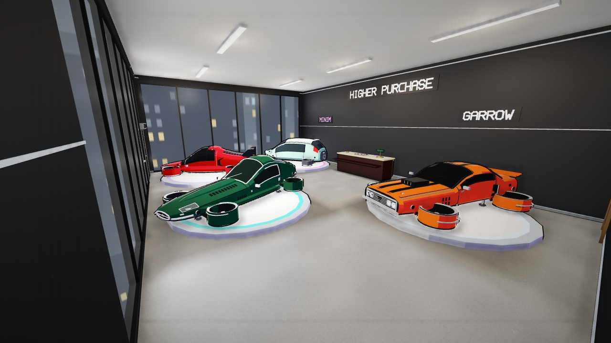
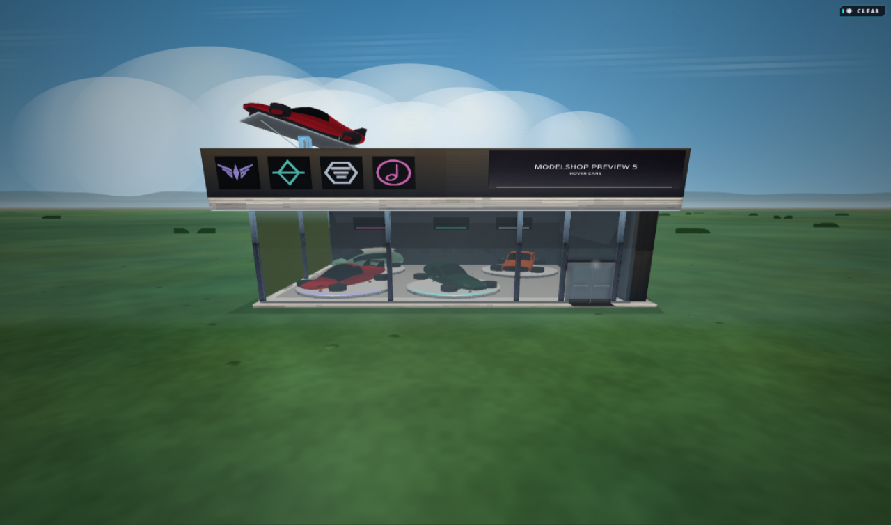

# The hover car dealership

**Status: built (2026-11-22). Higher Purchase stands at 912,908 on Marrow Street with its showroom, staff, four makers' cars and stock; Adequate! moved to 912,913 on Foundry Way. Section 8 lists what was checked and what is left.**

A showroom that sells mini VTOLs, the two-seat flying sports cars the Corvane Merlin started
([road-vtol.md](road-vtol.md)). The first one is on Marrow Street at 912,908, beside Marrow Street
Parking. More will follow in other places, so the building type, its sign and its sales rule carry
nothing of Coldwater's: this branch's name, site and staff are content.

Every dealership sells every maker. The cars and the three new makers are in
[hover-cars.md](hover-cars.md), which another session is writing.

## 1. The site

| tile | was | is |
|---|---|---|
| 912,908 | Adequate! (`dept_store`) | the dealership (`vtol_dealer`), door south onto Marrow Street |
| 912,913 | waste ground on the corner of Foundry Way and Meltwater Row (`zone_lot_912_913`) | Adequate!, moved whole, door north onto Foundry Way |

912,908 is a corner plot. Marrow Street runs along its south side and Meltwater Row along its west.
Marrow Street Parking, five black decks with a cyan sign, is on its east side, and The Flute, twelve
storeys of Solenne's champagne glass, is one tile further. Grass is behind it.

Adequate! moves rather than closes. `sitecheck.mjs` passes three plots it could take:

1. **911,907**, grass on Meltwater Row one tile north-west. It keeps its south door.
2. **912,913**, waste ground on the corner of Foundry Way and Meltwater Row.
3. **906,908**, the Vacant Plot on Greenside Row.

David picked 912,913. The move takes the facade's content to the new tile's zone and leaves every room, door,
furniture row and NPC with its id, the way The Slip and Any Port moved
([marrow-midrises.md](marrow-midrises.md), [grounds-for-concern.md](grounds-for-concern.md)). A moved
tile rolls a new `fh` and `h`, so the rooms are checked against the model afterwards.

## 2. The name

A shop's name is a pun followed by its trade ([building-styles.md](../reference/building-styles.md)
section 4.6). This branch is **Higher Purchase**, with HOVER CARS under it from `flags.sign_trade`.
It sells and it hires, and hire purchase is how people have always bought a car they can't afford.
The other two offered were Above Asking and Lift Off the Lot.

The name is on the tile, not in the arm. The arm's trade word is HOVER CARS (`SIGN_WORD`).

## 3. The building

A new type arm, `vtol_dealer`, in
[dealership.js](../../client/game/js/panels/glass/models/dealership.js). It's low, two tall
storeys between a five-deck garage and a twelve-storey block, so it's read by its shape and by what
is lit inside it, not by its height.

- **A glass box under a floating roof.** The front and the Meltwater Row side are glass from the
  floor to the roof slab, with thin dark mullions and no sill. The roof is a thin pale slab that
  stands forward of the glass over the pavement, with a light line under its edge. The east wall,
  against the garage, and the back are a dark core.
- **Four cars on turntables behind the glass**, one per maker, each with a ring in its maker's
  colour round it and the maker's plate on the core wall behind. They're what you see from the
  street, by day and after dark.
- **A fifth car is on the pylon** (`DEALER_PYLON`, whichever the dealership is showing off). A steel mast at the corner of the two streets carries a
  tilted deck above the roof with a car clamped to it, nose up and out over the junction, lit from
  under. It's the sign you read from the air and from three streets away.
- **A black sign band stands on the roof's two street edges.** On the front it carries four maker
  emblems in a row and the name once, with the trade under it; round the corner it says HOVER CARS.
- **Each maker has its own emblem**, told apart by its outline before anything in it is read, the
  way real marques are: Corvane's swept wings round a kite (an aerospace firm's, as Bentley's
  came from aero engines), Castellan's tower on a shield, Brakk's block B in a bolted octagon,
  and Vex's V in a circle. The last three are the cars' own drawings
  (`client/shared/hover-car-emblems.js`, the badge on each nose and wheel), so the sign and the
  car can't differ; Corvane's is in `DEALER_EMBLEMS`. Each is drawn in its maker's line colour and
  lit after dark.
- **A landing pad on the roof**, a yellow ring and an H in the middle of the slab with lamps round
  it. It's a real pad: the dealership is its own small VTOL field, so a car you buy is standing on
  it, a Merlin's LOCK catches it, and you land there to sell or service. A glazed lift head at the
  back of the roof is how a car gets from the floor to the pad.
- **The door** is a glass pair in the front, right of the turntables, under the roof's overhang,
  recorded with `markDoorway`.
- **Four sides.** The Meltwater Row side is glass round the corner and then core, with the
  workshop's roller door and a charge cabinet. The back has the lift shaft, a service door and two
  high windows. The garage side has slit windows.
- **Night is drawn on purpose.** The glass holds a cool white room, each turntable has a pool of
  light, the roof edge's line and the badges are lit, the pylon car is lit from below and the pad's
  lamps are on.
- **Nothing moves.** The turntables don't turn in GLASS. Movement is the exception for a small
  building, and a turning car would have to be a decal.

**Materials** are ones Marrow already has: Solenne's pale stone (`ty_marble_col`) for the roof slab
and the floor, Halcyon's mirror steel (`ty_hf_mirror`) for the mullions, mast and trim, and the
garage's black (`ty_sdeck_black`) for the core, so it sits between its two neighbours without a
palette of its own.

**The cars are real meshes.** The arm draws each display car from its vehicle mesh
(`meshFacesById`) in its livery, as adornment, so the collision capture never sees them. Which car
is on which bay comes from one table, `DEALER_BAYS` in
[client/shared/dealer-display.js](../../client/shared/dealer-display.js). The showroom in ROOM
reads the same table. Until a maker's car is built, its bay holds a Merlin in that maker's colour,
and swapping in the finished car is one line.

**Map icon:** `bldg_vtol_dealer.svg`, a wedge car over a pad ring, made in the same build.

## 4. The rooms

The rooms fit the model. One floor is walked, plus the roof.

| room | what it is |
|---|---|
| **The showroom** (`zone_dealer_marrow_showroom`) | The glass box. Four bays, one per maker, each a round plinth with the car on it, the maker's badge on the wall behind and the maker's colour in the floor. The sales desk is at the back, flagged `serves`. To the [shop-interiors](shop-interiors.md) standard: `face`, `doors`, `street_door`, `panes` on the front and the Meltwater Row wall |
| **The plant room** | Under the showroom: the junction box and the chargers' switchgear |

Every room has a `power_zones` row and a light.

The four plinths in ROOM are the four turntables in GLASS: `flags.room.display` is written from
`DEALER_PLAN`, the numbers the arm builds from, and drawn by `panels/room-hoist.js`.

**Staff.** Two people on the floor, both with plain names and plain speech
([house-voice.md](../reference/house-voice.md)): Lucian Varney, the sales manager, behind the desk, and Marlowe Dax,
the technician, who talks about charge and fans. They share The Flute 7B. Neither sells through a shop panel:
the desk opens the dealer's counter.

**The showroom computer** stands beside the sales desk (`flags.room.kiosk`, a pedestal with a glass screen). Walk up to
it in ROOM and it shows every car the dealer sells or hires, turning in 3D, with BUY and RENT keys that send `buy <type>`
and `rent <type>`, and your own cars here with SERVICE. It's the hangar's display (room-hangar-kiosk.js) on the flight
plugin's `aircraft_desk` stand kind, the same as the airport terminal's: a room with a display and no `stand` is a desk,
so nothing is brought down onto the showroom floor and `callup` sends you out to the roof pad.

**The cars wait next door.** The facade carries `flags.delivers_to: zone_seam_914_908`, Marrow Street Parking's field,
so a car bought or hired here is parked on that garage's roof pad (acquisition.js `park`), not on the dealer's own.
The sale says so, and the showroom computer then lists her under YOURS as waiting on the roof, with a TO THE LIFT key.
The lift (`zone_dealer_marrow_lift`, an elevator off the showroom, `in`) has two stops, the showroom and the roof
pad; from the pad it's `west`. Stepping out onto the pad offers the new car with a Call her up link
(`embark <id>`; acquisition.js `noteDelivery`, RAM only, an hour). Any dealer can deliver to another field this way.

## 5. Sales

No new plugin and no new verb. The flight plugin already sells, hires, stores, services and buys
back aircraft at any field with a dealer and a rental desk ([systems-flight.md](../systems-flight.md)),
and a hover car is an aircraft row. So the dealership is a field:

- **The facade is a VTOL-only airfield** (`af_dealer_marrow`: `dealer`, `rental`, `vtol_only`, `charge`
  only). Its roof pad is where a bought or hired car stands and where you land to come back.
- **The showroom names that field** with `flags.hangar_ramp`, as a terminal's
  rooms do. So `buy`, `rent`, `sell`, `hangaract`, `repair`, `refuel`, `tune` and `paintset` all
  work inside, the hangar counter is dealt when you walk in and closed when you leave, and the log
  rung prints the same list as text.
- **The stock is the hover cars and nothing else.** The field's tile carries
  `flags.dealer_stock: "hover_car"`, and `acquirableTypes` (flight/state.js) then offers only the
  `aircraft_types` rows whose `data.segment` is `hover_car`. That's content on both sides: a fifth
  car appears in every dealership when its row is marked, and a dealership in another town is a
  tile with the flag. A field without the flag sells what it sold before.
- **To the depot standard** ([depot-shell.md](../reference/depot-shell.md)) by inheritance: the
  counter is `hangar-bay.js` on the shared shell, a card seats you (`hangaract launch`), the bay
  overlay services the car on the pad, selling is held, and a purchase ends with the Fly her key.
- **Parking is next door.** The roof pad holds the car you just bought; Marrow Street Parking's
  carousel is where you keep it, free, with `garage park` and a ticket. The sales manager says so.

What this leaves out is in section 7.

## 6. Building it, in order

1. The arm, the display table, the registrations, the icon and the bakes.
2. `scripts/content/vtol-dealership.mjs`: the facade, rooms, power, lights, fittings, staff and the
   airfield row.
3. `dealer_stock` in the flight plugin, with its regress checks, flags-keys row and tagCatalog
   entry.
4. Adequate!'s move, once the plot is picked.
5. The finished cars onto their bays as the cars session lands them.

## 7. Not in this build

- The turntables turning in GLASS.
- A test flight as its own thing. Hiring a car for an hour is the test flight.
- One car per pad. Nothing yet stops two cars standing on the roof pad, as nothing stops two
  Merlins locking onto one car park pad.
- Finance. The name is a joke about it; you pay in full.

## 8. Where it stands (2026-11-22)

- **Checked by eye:** the arm in the Modelshop by day and night, from the street, the corner and the air; the showroom in the Room Lab with all four cars; the street door, which fits the model's own doorway (`street-doors.mjs --list`: 1.6 m wide, 2.1 m high).
- **Not checked by eye:** the building in the game itself, beside the garage and The Flute, and Adequate! on its new plot.
- **Gates run and green:** `content/lint.mjs`, `shapes/smoke.mjs`, `lite/smoke.mjs` after `lite:bake`, `street-doors.mjs`, `content/building-stage.mjs`, `perch.mjs`, `anchored.mjs`, `armtables.mjs`, `imports/smoke.mjs`, `docs/links.mjs`.
- **Gates red for other buildings:** `room-stage.mjs` (six rooms, none here) and `glmesh.mjs` (`otoolessurplus`).
- **The mesh budget went up by 4,500 faces** (`glmesh.budget.json`), which is the five display cars: body and glass at full detail, the fan ducts coarse, no feet.
- **Not run:** `npm run test:regress` (it stops the dev server), so the new flight checks are unproven.
- **Adequate! has no `flags.room`**, so there was nothing to re-fit when its tile moved; its model is bound by name and went with it.
- **Lights import off.** After a deploy, `node --env-file=.env.prod scripts/content/seed-runtime.mjs` turns the showroom's on.
- **The Lite bake and the flight-world snapshot are in the working tree, not in this commit.** Both are single files that also carry other sessions' uncommitted buildings.
- After dark the cars behind the glass are dimmer than they should be.
- A callup stand in the showroom, so your own car comes down the lift onto the floor, isn't built.
- In the Modelshop the name board shows the preview's placeholder name; in the world it's the tile's.
